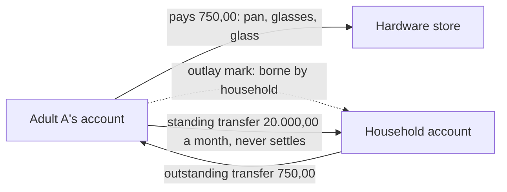

# ADR-021: Give Every Account an Owner and Track Outlays as Outstanding Transfers

**Status:** Proposed. Amends [ADR-011](ADR-011-classification-precedence.md):
a rule or a decision can also say which account bears a transaction's cost.
Replaces the first-release statement in `domains/account.md` that there is no
person dimension.

## Context

A household imports every account it owns: each adult's own accounts, its
shared accounts (for example household, groceries and vacation), and the
children's accounts. Households differ, so the accounts, their owners and what
each shared account is for are the household's own declarations, not fixed in
the code.

A household member often pays a cost that belongs to a shared account from
their own account, because the shared account has no card or is empty at the
time. For example, adult A pays for a pan (150,00), glasses (500,00) and a
glass (100,00) at a hardware store from A's own account. These are household
costs. Until the household account transfers 750,00 back, A's account is
750,00 lower than it should be, and the household account is 750,00 higher.

The same example as balances, applying the decisions below. Adult A starts with
30.000,00 and the household account with 5.000,00.

| Step | A actual | A after outstanding | Household actual | Household after outstanding | Outstanding, household to A |
| --- | ---: | ---: | ---: | ---: | ---: |
| Start | 30.000,00 | 30.000,00 | 5.000,00 | 5.000,00 | 0,00 |
| A pays 750,00 at the hardware store; the three purchases are marked as household outlays | 29.250,00 | 30.000,00 | 5.000,00 | 4.250,00 | 750,00 |
| A's standing transfer of 20.000,00 to the household account | 9.250,00 | 10.000,00 | 25.000,00 | 24.250,00 | 750,00 |
| The household account transfers 750,00 to A | 10.000,00 | 10.000,00 | 24.250,00 | 24.250,00 | 0,00 |

The 750,00 counts as the household account's spending, in the purchases'
categories, and not as A's. The standing transfer leaves the amount
outstanding unchanged; only the other transfer settles it.

The household calls this an *udlæg* (outlay). It is not a *refundering*
(refund), which is a merchant paying money back; refund linking is a separate
0.7 outcome.

Today nothing records that a cost belongs to another account. The account
registry has an ownership scope (`household` or `person`) but no owner, and a
transfer between two imported accounts is just a transfer. The household wants
to see, per person, per account and for the whole household:

- what each account has really spent;
- each account's actual balance and the balance it should have;
- a list of outstanding transfers still to make in the bank.

## Decision

- **Every account has an owner.** The registry names an owner per account from a
  household-declared list, such as `adult-a`, `adult-b`, `household` and
  `children`. Reports can select one owner, one account, or any set of accounts.
- **The category does not change.** Rules (`rules.toml`) and decisions classify
  as today ([ADR-011](ADR-011-classification-precedence.md)). A NETTO purchase
  on adult A's account is A's own food spending unless it is marked.
- **An outlay mark names the bearing account.** A transaction paid from account A
  can be marked as borne by account B. A rule in `rules.toml` or a manual
  decision can set the mark, and a decision beats a rule, as for categories.
  Removing a mark is a `retract` decision in the append-only log.
- **Spending follows the bearing account.** A marked transaction counts as B's
  spending, in its unchanged category, and not as A's. A's bank balance is
  unchanged.
- **Each marked transaction creates an amount outstanding from B to A.** The
  outstanding amounts form the list of transfers still to make.
- **Standing transfers are declared, not inferred.** A household inputs file
  lists the regular transfers (from, to, amount, about which day), such as
  20.000,00 a month from adult A to the household account. A transfer matching a
  standing transfer is never a settlement.
- **Any other transfer from B to A settles automatically.** It reduces the
  amount outstanding, oldest marked transactions first. A payment above what is
  outstanding leaves the excess owed the other way and raises an
  `outlay-overpaid` review item. Retracting a mark that was already settled has
  the same effect.
- **Two balances per account.** The actual balance leads, as the bank shows it.
  Beside it is the balance after outstanding transfers, and the amount
  outstanding. Across the whole household the outstanding amounts net to zero.
- **Marks restate history** like any decision. Marking an April purchase in June
  changes April under today's interpretation; the as-was view
  ([ADR-014](ADR-014-gold-publications-and-history.md)) still shows April before
  the mark.
- **Marks are made in the CLI.** The dashboard stays read-only for now.
- **Everyone sees every account.** Both adults can select any account or
  owner, including the other adult's personal accounts. There is no per-person
  access control.
- **Trip coverage comes from outlays.** A trip paid from personal accounts is
  covered when its purchases are marked as borne by the vacation account and
  the outstanding transfers are settled. The trip-tag versus transfer comparison
  in #159 is dropped; trip tags still give the trip's cost by category and keep
  it out of everyday budget comparisons.

## Considered Options

- **Derive the bearer from the category** (every grocery is a groceries-account
  cost). Rejected: the same category can be a person's own spending or a common
  cost, as with chocolate bought for oneself versus nappies bought for the
  household.
- **Let any transfer between the pair settle.** Rejected: the monthly
  contribution would absorb outstanding outlays.
- **Link each settlement to the purchases it pays for.** Rejected: one running
  amount per account pair, settled oldest first, matches how the household pays
  outlays back in bundles, and needs no decision per transfer.
- **A separate release for outlays.** Rejected: 0.7 already owns where money
  really belongs (fixed commitments, trips, refunds), and refunds and outlays
  share the linking of one transaction to another. One release means one design
  and one schema bump per store.

## Consequences

- `domains/account.md` gains the owner; `CONTEXT.md` gains *Owner*, *Outlay*
  (*udlæg*), *Bearing account*, *Standing transfer* and *Outstanding transfer*,
  and keeps *Refund* (*refundering*) for merchant refunds.
- `classification.md` gains the outlay mark in rules and decisions, and the
  `outlay-overpaid` review item.
- The Gold contract gains the bearing account on each fact, the outstanding
  amounts per account pair, and the second balance.
- Suggestions for marks (for example, nappies on a personal account suggested
  as a household outlay) come later, with the suggestions feature.
- 0.7's definition of done (#436) gains two outcomes: every account has an
  owner, and outlays with outstanding transfers; tracked in #477.
